<div align="center">

<!-- Terminal-inspired profile README for @nathaliadebellis -->


<br/>


</div>

```bash
┌──(nathalia㉿github)-[~/profile]
└─$ ./iniciar-perfil.sh
[ OK ] Carregando projetos
[ OK ] Preparando testes
[ OK ] Aprendizado contínuo iniciado...
```

## `> sobre_mim`

Sou estudante de **Análise e Desenvolvimento de Sistemas** e desenvolvedora de software júnior, com foco em **backend**. Trabalho com **C# e ASP.NET Core** e estou expandindo minha base para o ecossistema **Java e Spring Boot**. Meu diferencial é o olhar de qualidade: escrevo código pensando em como ele será testado e mantido.

Gosto de transformar problemas em soluções práticas e aprender construindo projetos.

- `dev`: C#, ASP.NET Core, Java e Spring Boot (em estudo)
- `qa`: Python, Selenium WebDriver e PyTest
- `data`: SQL e bancos relacionais
- `mindset`: boas práticas, testes e melhoria contínua

### `> o_que_busco`

Uma oportunidade como **desenvolvedora júnior** (backend / full stack) em um time onde eu possa contribuir com código de qualidade, aprender com pessoas mais experientes e crescer junto com o produto.

## `> projetos_em_destaque`

<table>
<tr>
<td width="50%" valign="top">

### `01 // SmartWallet`

Aplicação web de gestão financeira pessoal, desenvolvida com C# e ASP.NET Core MVC. O projeto explora arquitetura em camadas, persistência de dados e organização do código.

**Stack:** `C#` `ASP.NET Core MVC` `Entity Framework Core` `SQL Server` `Bootstrap`

<a href="https://github.com/nathaliadebellis/SmartWallet">
  
</a>

</td>
<td width="50%" valign="top">

### `02 // Test Automation`

Projeto de automação de testes web com Python, Selenium WebDriver e PyTest, incluindo práticas de testes end-to-end e organização com Page Object Model.

**Stack:** `Python` `Selenium` `PyTest` `WebDriver Manager`

O repositório de automação pode ser encontrado na lista de repositórios do perfil.

<a href="https://github.com/nathaliadebellis?tab=repositories">
  
</a>

</td>
</tr>
</table>

## `> stack_tecnologica`

<div align="center">

**Desenvolvimento**


**Qualidade e automação**


**Dados e ferramentas**


</div>

## `> github_stats`

<div align="center">

<a href="https://github.com/nathaliadebellis">
  
</a>
<a href="https://github.com/nathaliadebellis">
  
</a>

<a href="https://github.com/nathaliadebellis/SmartWallet">
  
</a>

</div>

> Os cards são gerados pelo GitHub Actions. Na primeira configuração, execute manualmente os workflows para criar os arquivos SVG.

## `> atualmente`

```text
[+] Evoluindo projetos pessoais em C# / .NET
[+] Estudando Java e Spring Boot (APIs REST, Spring Data JPA)
[+] Praticando automação de testes com Python, Selenium e PyTest
[+] Estudando qualidade de software e boas práticas de desenvolvimento
```

## `> contato`

<div align="center">

<a href="https://github.com/nathaliadebellis">
  
</a>

<a href="https://www.linkedin.com/in/nathalia-de-bellis">
  
</a>
<a href="mailto:nathaliadebellis@hotmail.com">
  
</a>

</div>

```bash
$ echo "Obrigada pela visita. Vamos construir algo útil?"
```

<div align="center">
  
</div>
